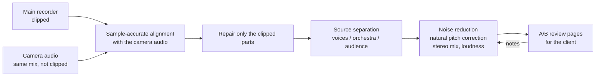

# Live-concert audio restoration

Restored the audio of a live symphonic gala by the tenor group Áncora with orchestra (Teatro Municipal de Lima, February 2026), bringing a damaged live recording to studio quality.

## The problem

- The main recorder (console line, mono, 96 kHz / 32-bit float) **clipped on every loud passage**. That was the "distortion" in the singers' voices.
- One camera had recorded the **same console mix without clipping**, but at a different level and sample rate.
- Voices and orchestra were mixed together in a single mono track, and some songs needed gentle pitch correction.

## How it works

- **Repair:** the camera track turned out to be the same console mix, with a coherence of 0.9997. After aligning it to the microsecond, it was used to rebuild only the clipped regions of the main recording.
- **Separation:** open-source models through audio-separator and UVR (Mel-Band RoFormer and BS-RoFormer for the voices, a crowd model for applause, and a wind-instrument model for a trumpet solo). This made it possible to rebalance voices and orchestra and build a stereo mix.
- **Correction without over-processing:** pitch was corrected only on the notes that measured out of tune, and only as much as needed.
- **Review:** each round was shared as a web page with an instant switch between the before and after versions, so the client could mark exactly what sounded wrong.

## Results

- 21 songs processed and reviewed with the client through A/B listening pages.
- Heavy steps were batched and spread across three machines (see [multi-machine-ai-workshop](https://github.com/Jheremyt96/multi-machine-ai-workshop)).

## Stack

Python (NumPy, SciPy, librosa, pyloudnorm, pedalboard) · audio-separator / UVR models · DeepFilterNet · ffmpeg · sox

---

The audio and the code are private because the recording belongs to the client. I'm happy to walk through the process on a call.

© 2026 Jheremyt Salazar. All rights reserved.
